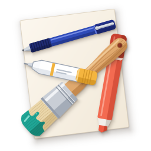

<h1 align="center">纸笔 · Pen &amp; Paper</h1>

只做绘画的 Windows 绘画软件 · A painting program for Windows that does painting and nothing else

[中文](#中文) · [English](#english)

---

## 中文

纸笔只处理画画这一件事：起草、勾线、上色。它不做照片处理、排版、动画，界面上默认只有画画用得到的东西。

### 有什么

- **跟手**：笔的每个样本都立刻画到屏幕上。开发机上用合成输入测得：关掉稳定器时墨迹落后笔尖约 6 毫秒，240 Hz 屏幕上每秒更新约 230 次。
- **稳定器** 0 到 15 档，抬笔时线一定画到抬笔的位置。
- **笔刷**：笔、马克笔（叠涂不会越叠越深）、喷枪、橡皮，共用一套参数（大小、最小大小、浓度、最小浓度、边缘硬度），压力控制粗细或浓淡。
- **选区与填充**：选框、套索、魔棒；油漆桶带"缝隙闭合"，线稿留着小缺口也不漏色。
- **移动与自由变换**：手柄在画布上，确定和取消在面板里，全程没有对话框。
- **图层**：8 种混合模式、不透明度、保护不透明度、锁定、剪贴、向下合并、合并可见图层、拼合、白底变透明。
- **视图**：以光标为中心缩放、旋转、镜像，按住空格平移。
- **文件**：自己的格式 `.zhibi`（压缩包里是 JSON 和逐层 PNG，每通道 15 位精度）；PSD、ORA 的打开和导出；导出 PNG。
- **其他**：快捷键可以改；按住工具键画一笔再松开是临时借用这个工具；笔身按键切到橡皮时自动换成橡皮；Windows 笔输入和 Wintab 都支持；中文、英文界面。

### 系统要求与安装

Windows 10 或 11，64 位。目前没有安装包，需要自己编译：

1. 安装 [Rust](https://www.rust-lang.org/)（稳定版，Windows 默认的 MSVC 工具链）。
2. 在 `src` 目录下运行 `cargo build --release`。
3. 程序在 `src/target/release/zhibi.exe`，单个文件，不需要安装。

设置保存在 `%APPDATA%\Zhibi\settings.txt`，删掉它就回到出厂状态。

### 常用按键

| 按键 | 作用 |
|------|------|
| B / N / A / E | 笔 / 马克笔 / 喷枪 / 橡皮 |
| G / M / L / W / V | 油漆桶 / 选框 / 套索 / 魔棒 / 移动 |
| `[` `]` | 笔刷小一档 / 大一档 |
| 1 … 9、0 | 浓度 10% … 90%、100% |
| X | 交换前景色和背景色 |
| 空格拖动 / Alt+空格拖动 / Alt 点击 | 平移 / 旋转视图 / 吸管 |
| PageUp / PageDown / Home | 放大 / 缩小 / 回到全图 |
| H | 镜像查看 |
| Ctrl+T | 自由变换 |
| Ctrl+Z / Ctrl+Y | 撤销 / 重做 |
| Tab | 隐藏或显示面板 |

全部按键可以在"编辑 → 快捷键…"里改。

### 目录

- `src/`：程序本身。`core` 是与平台无关的部分（笔画、图层、撤销、文件格式），`app` 是 Windows 界面。
- `tools/`：开发时用的测量工具（笔输入记录、合成笔画注入与带时间戳抓屏、后台界面驱动、图标生成）。

### 许可证

GPL-3.0-or-later，见 [LICENSE](LICENSE)。

---

## English

Pen & Paper does one thing: drawing and painting — sketching, inking and colouring. No photo editing, layout or animation; by default the interface shows only what painting needs.

### Features

- **Responsive**: every pen sample is drawn immediately. Measured on the development machine with synthetic input: about 6 ms from pen to ink with the stabilizer off, about 230 screen updates per second on a 240 Hz display.
- **Stabilizer** with 16 levels (0–15); a stroke always ends exactly where the pen was lifted.
- **Brushes**: pen, marker (overlapping strokes don't get darker), airbrush, eraser — one set of parameters (size, min size, density, min density, hardness); pressure controls width or density.
- **Selection and fill**: rectangle, lasso, magic wand; the paint bucket has *gap closing*, so line art with small gaps doesn't leak.
- **Move and free transform** with on-canvas handles and OK/Cancel in the panel — no dialogs.
- **Layers**: 8 blend modes, opacity, protect opacity, lock, clipping, merge down, merge visible, flatten, white to transparent.
- **View**: zoom at the cursor, rotate, mirror, hold Space to pan.
- **Files**: own format `.zhibi` (a ZIP with JSON and one PNG per layer, 15 bits per channel); open and export PSD and ORA; export PNG.
- **More**: customizable shortcuts; hold a tool key, draw, release to borrow a tool for one stroke; switches to the eraser when the pen's button flips it to eraser mode; Windows Ink and Wintab pen input; Chinese and English interface.

### Requirements and building

Windows 10 or 11, 64-bit. There is no installer yet; build it yourself:

1. Install [Rust](https://www.rust-lang.org/) (stable, the default MSVC toolchain on Windows).
2. Run `cargo build --release` in the `src` folder.
3. The program is `src/target/release/zhibi.exe`, a single file that needs no installation.

Settings live in `%APPDATA%\Zhibi\settings.txt`; delete it to go back to the defaults.

### Common keys

| Key | Action |
|-----|--------|
| B / N / A / E | Pen / Marker / Airbrush / Eraser |
| G / M / L / W / V | Bucket / Rectangle select / Lasso / Magic wand / Move |
| `[` `]` | Smaller / bigger brush |
| 1 … 9, 0 | Density 10 % … 90 %, 100 % |
| X | Swap foreground and background colour |
| Space-drag / Alt+Space-drag / Alt-click | Pan / rotate view / pick colour |
| PageUp / PageDown / Home | Zoom in / zoom out / reset view |
| H | Mirror view |
| Ctrl+T | Free transform |
| Ctrl+Z / Ctrl+Y | Undo / redo |
| Tab | Show or hide panels |

All keys can be changed in *Edit → Keyboard Shortcuts…*.

### Layout

- `src/`: the program. `core` is platform independent (strokes, layers, undo, file formats); `app` is the Windows user interface.
- `tools/`: development tools (pen input recorder, synthetic stroke injection with timestamped screen capture, background UI driver, icon generator).

### License

GPL-3.0-or-later, see [LICENSE](LICENSE).
